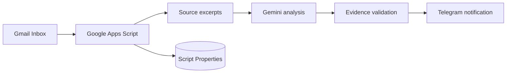
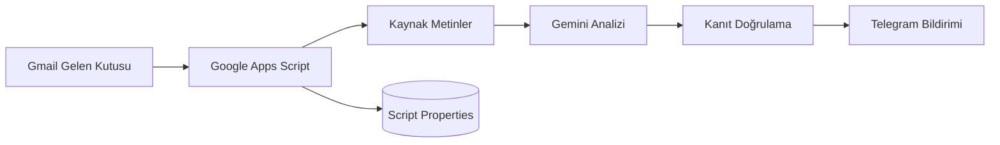

# 🛡️ AI-Email-Guardian

**An AI-powered email assistant that turns a crowded Gmail inbox into clear, actionable Telegram notifications.**

AI-Email-Guardian is a serverless automation built with Google Apps Script, Gemini and the Telegram Bot API. It reads recent incoming emails, identifies their priority, summarizes the information that matters and highlights actions only when something actually needs to be done. Special attention is given to financial amounts, dates and consequential decisions.

## ✨ Features

- **Smart email triage:** Critical, Important, Normal and Spam classifications.
- **Concise Turkish summaries:** One to three useful points instead of generic filler.
- **Evidence-grounded output:** Summary points reference excerpts from the original email.
- **Numerical safeguards:** Checks dates and amounts against the source, including currency and exact number formatting.
- **Decision-aware checks:** Additional guardrails for payments, refunds, application acceptances and rejections.
- **Action detection:** Shows a next step only when the email actually calls for one, regardless of priority.
- **Clean Telegram notifications:** Priority, category, sender, summary, optional action and a direct Gmail link.
- **Reply-aware processing:** Recognizes new messages in previously processed conversations.
- **Serverless operation:** No dedicated server or database required.

## 🏗️ Architecture



The assistant extracts short, numbered excerpts from an email. Gemini summarizes them in structured JSON and cites the excerpts supporting each statement. Local validation checks numbers, currencies and certain high-impact outcomes. If a statement does not pass validation, the notification uses relevant original wording rather than inventing a conclusion.

## ⚙️ Setup

**Requirements:** A Google account, a Gemini API key, a Telegram bot and its target chat ID.

1. Open [Google Apps Script](https://script.google.com/) and create a project (or open your existing one).
2. Copy the full contents of [`Code.js`](./Code.js) into the Apps Script editor.
3. Under **Project Settings → Script Properties**, add:

   | Property | Purpose |
   | --- | --- |
   | `GEMINI_KEY` | Gemini API key |
   | `TG_TOKEN` | Telegram bot token |
   | `TG_CHAT_ID` | Destination chat ID |

4. Save the project and run `testNumericSafety` to check numerical safeguards.
5. Run `testTelegram` to send a sample notification and authorize the required permissions.
6. Create **one time-driven trigger** for `checkAndProcessEmails` at your preferred interval.

**Important:** Changes pushed to GitHub do **not** automatically update a deployed Apps Script project. Copy the updated `Code.js` into Apps Script to deploy changes.

### Local tests

Requires Node.js 18 or later; no additional packages are necessary.

```bash
node --check Code.js
node --test tests/guardian.test.cjs
```

## 🔐 Privacy & reliability

API credentials are read from Script Properties, never hard-coded. Emails are processed by Google Apps Script and relevant content is sent to Gemini for analysis; notification summaries are delivered to Telegram. The workflow does not intentionally archive, delete or mark emails as read.

AI-assisted summarization is **not infallible**. Validation reduces numerical and meaning-related errors but cannot prove every paraphrase. Verify significant financial, security and application decisions using the original email. Notifications follow the configured trigger schedule, not a guaranteed instant delivery time; retries may occasionally cause a duplicate.

**Stack:** JavaScript (Apps Script V8) · GmailApp · Gemini Interactions API · Telegram Bot API · PropertiesService · Node.js test runner

---

# 🇹🇷 Türkçe

**Gmail kutusundaki önemli bilgileri sade, anlaşılır ve gerektiğinde aksiyona dönüştüren yapay zekâ destekli e-posta asistanı.**

AI-Email-Guardian; Google Apps Script, Gemini ve Telegram Bot API kullanılarak geliştirilen sunucusuz bir otomasyondur. Gelen e-postaları önem derecesine göre sınıflandırır, gerçekten gerekli bilgileri özetler ve yalnızca işlem gereken durumlarda yapılacak adımı gösterir. Özellikle para tutarları, tarihler ve önemli kararların yanlış aktarılmaması için ek doğrulamalar uygular.

## ✨ Özellikler

- **Akıllı önceliklendirme:** Kritik, Önemli, Normal ve Spam sınıflandırması.
- **Kısa ve anlamlı özetler:** Her e-posta için ihtiyaca göre 1–3 bilgi maddesi.
- **Kaynağa dayalı analiz:** Özetler, e-postadan alınan ilgili metin parçalarıyla ilişkilendirilir.
- **Sayısal kontroller:** Tutar, para birimi, tarih ve sayıların kaynakla karşılaştırılması.
- **Karar doğrulaması:** Ödeme/iade ve kabul/ret gibi önemli ifadeler için ek korumalar.
- **Gerçek aksiyon tespiti:** Önem seviyesinden bağımsız olarak yalnızca gerektiğinde işlem gösterimi.
- **Modern Telegram görünümü:** Öncelik, kategori, gönderen, özet, varsa yapılacak işlem ve Gmail bağlantısı.
- **Yeni yanıtları algılama:** Daha önce işlenmiş e-posta konuşmalarındaki yeni mesajların kontrolü.
- **Sunucusuz mimari:** Ayrı bir sunucu veya veritabanı gerektirmez.

## 🏗️ Mimari



Sistem e-postadan numaralandırılmış kısa kaynak parçaları oluşturur. Gemini bu parçaları referans göstererek yapılandırılmış bir özet üretir. Kod; sayıları, para birimlerini ve belirli kritik sonuç ifadelerini kontrol eder. Doğrulamadan geçmeyen bir ifade varsa uydurma bilgi göndermek yerine ilgili orijinal metin kullanılır.

## ⚙️ Kurulum

**Gereksinimler:** Google hesabı, Gemini API anahtarı, Telegram botu ve sohbet kimliği.

1. [Google Apps Script](https://script.google.com/) üzerinden bir proje oluştur veya mevcut projeni aç.
2. [`Code.js`](./Code.js) dosyasındaki kodun tamamını Apps Script editörüne yapıştır.
3. **Proje Ayarları → Komut Dosyası Özellikleri (Script Properties)** alanına şunları ekle:

   | Anahtar | Açıklama |
   | --- | --- |
   | `GEMINI_KEY` | Gemini API anahtarı |
   | `TG_TOKEN` | Telegram bot token'ı |
   | `TG_CHAT_ID` | Bildirim gönderilecek sohbet kimliği |

4. Projeyi kaydet ve sayısal doğrulamayı kontrol etmek için `testNumericSafety` fonksiyonunu çalıştır.
5. `testTelegram` ile bir örnek bildirim gönder; gerekli Google izinlerini onayla.
6. `checkAndProcessEmails` fonksiyonu için istediğin sıklıkta **tek bir zaman tetikleyicisi** oluştur.

**Not:** GitHub'da kodun güncellenmesi, çalışan Apps Script projesini kendiliğinden güncellemez. Yeni `Code.js` dosyasının Apps Script'e aktarılması gerekir.

### Yerel testler

Node.js 18 veya üzeri yeterlidir; ek paket kurulumu gerekmez.

```bash
node --check Code.js
node --test tests/guardian.test.cjs
```

## 🔐 Gizlilik ve güvenilirlik

API anahtarları kodda değil, Script Properties içerisinde tutulur. E-postalar Google Apps Script tarafından okunur; ilgili içerik analiz amacıyla Gemini'ye, özet bildirimler ise Telegram'a gönderilir. Otomasyon e-postaları bilerek silmez, arşivlemez veya okundu olarak işaretlemez.

Yapay zekâ özetleri **%100 doğruluk garantisi vermez**. Doğrulama katmanı hata riskini azaltır ancak tüm anlam hatalarını kesin olarak engelleyemez. Finansal işlemler, güvenlik bildirimleri ve başvuru sonuçları için orijinal e-posta esas alınmalıdır. Bildirimler belirlenen tetikleyici aralıklarında üretilir; bazı geçici hatalar veya tekrar denemeler mükerrer bildirim oluşturabilir.

**Teknolojiler:** JavaScript (Apps Script V8) · GmailApp · Gemini Interactions API · Telegram Bot API · PropertiesService · Node.js test runner